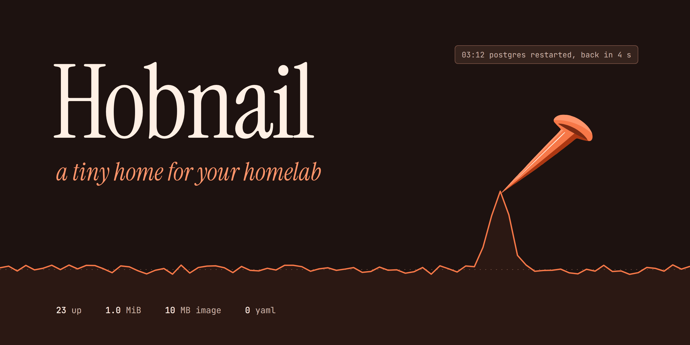
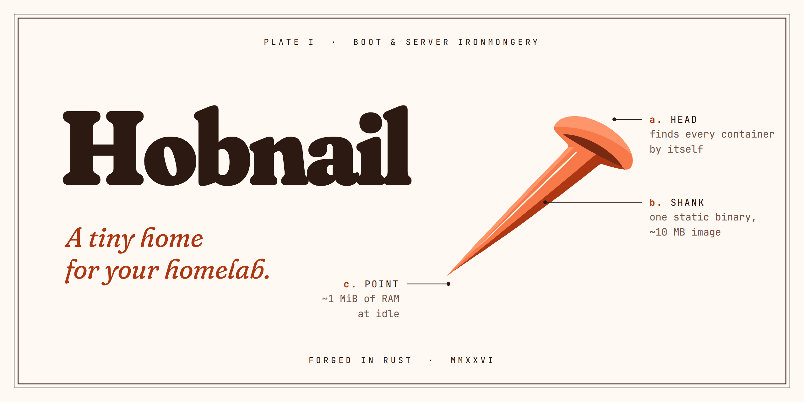

<p align="center">
  
</p>

# Hobnail

**A tiny home for your homelab.**

Hobnail is a home-server dashboard written in Rust: one static binary in a
~10 MB `scratch` image, idling at about 1 MiB of RAM. It discovers every Docker container by
itself (no generated YAML, no watchdog), shows host stats and their **history**,
pulls data from any JSON API, sends notifications when something breaks and
recovers, and can be **configured from the browser** behind a login.

<p align="center">
  
</p>

## Quick start

Hobnail runs as one container next to the ones it watches. You need Docker with
Compose.

```sh
git clone https://github.com/Rami-0/hobnail.git
cd hobnail
docker build -t hobnail:latest .
docker compose -f deploy/compose.yaml up -d
```

Open <http://127.0.0.1:3200>. With no configuration at all it lists every
container on the host, grouped by Compose project, with host stats alongside.

To reach it from other machines, publish the port on your LAN or VPN address in
`deploy/compose.yaml` (see [Run and redeploy](#run-and-redeploy)).

Everything Hobnail stores is in the `data/` folder next to the compose file:

| File | What it is |
|---|---|
| `config.toml` | Optional overrides and additions; hot-reloaded |
| `hobnail.db` | History |
| `custom.css`, `icons/` | Your theming and icons |
| `secrets/`, `../secrets.env` | Tokens for notification channels (see [Notifications](#notifications)) |

More detail: [docs/features/](docs/features/) has one short note per feature,
[GOALS.md](GOALS.md) is the spec, [docs/DESIGN.md](docs/DESIGN.md) the design,
[docs/measurements.md](docs/measurements.md) the numbers and
[docs/BRANDING.md](docs/BRANDING.md) the brand.

## Set the password (once)

Viewing needs no login. **Changing anything from the browser does**, and until
a password exists the app is read-only. Set it on the host:

```sh
docker exec -it hobnail /hobnail set-password
```

It asks twice without echoing (or reads one line from stdin:
`echo 'passphrase' | docker exec -i hobnail /hobnail set-password`).
Then sign in at `/login`. Running it again changes the password and signs out
every session.

Why on the host and not a web form: once the browser can write the config,
anyone who reaches the port could otherwise add a `command` widget, which runs
shell commands inside a container that has the Docker socket. A web "claim the
first password" form would let anyone on the LAN race you to it. Details:
[docs/features/login.md](docs/features/login.md).

## Using it

<p align="center">
  
</p>

- **Pages:** Overview, Containers (sortable, filterable table; group by stack or
  flat), a page per container (charts, event timeline, ports, labels, alert
  rules), History (1 h … 30 d host charts, restarts per day, incidents),
  Alerts, Settings.
- **Command palette:** `Ctrl/⌘ K` or `/` — jump to any container, page,
  bookmark or settings section, open logs in Dozzle, toggle the theme; Enter on
  no match searches the web.
- **Theme:** dark by default, light follows the OS, ◐ overrides per browser.
- The sidebar lists every compose stack; it collapses to an icon rail and
  becomes a drawer on phones.

- **Logs:** `/containers/<name>/logs` (or `l` on a container), a whole stack at
  `/stacks/<name>/logs`, side by side at `/logs?c=a,b`. Live tail, search and
  regex, levels, JSON, ANSI colours, download, permalinks. Logs **need a
  login by default** (they often contain secrets); set `[logs] require_login =
  false` to open them like the rest of the page. Hidden/excluded containers
  have no logs view. Alerts on log lines: rule `type = "log_match"` (pattern, containers
  or stack, count within window). See [docs/features/logs.md](docs/features/logs.md).
- **Host:** `/host` (or click the CPU/MEM/DISK chips) — per core, pressure
  stall, memory and swap activity, disks, interfaces, sensors, and which
  container is using the host. See [docs/features/host.md](docs/features/host.md).
- **Container detail** tabs: Overview, Logs, Metrics (network, block I/O,
  PIDs, throttling, OOM), Inspect (env values, commands and health-check output
  only when signed in), Processes (signed in), Events.
- **Keyboard:** `g` then `o c h l a s` jumps to a page, `j/k` moves in lists,
  `?` shows all shortcuts. **Themes:** Dark, Light, Ember, High contrast
  (◐ button or Settings → Appearance). **Install** it from the browser menu
  ("Add to Home Screen"); the tab title shows the number of problems.

## Run and redeploy

No Rust toolchain is needed on the host; everything builds in Docker.

```sh
scripts/deploy.sh        # build (fmt + clippy + tests gate the build), deploy, health-check
scripts/measure.sh       # RAM / image size / cold start / page load, as markdown
scripts/cargo.sh test    # run cargo in the dev container (also: clippy, fmt, build)
```

`deploy.sh` tags the image `hobnail:latest` and `hobnail:<git sha>`,
copies `deploy/compose.yaml` to the stack folder (`STACK`, default
`/opt/stacks/hobnail`), runs `docker compose up -d`, waits for the healthcheck
and curls every published address.
Open pages notice the new build and reload themselves. The page footer shows the
build SHA, build time and uptime.

Manual equivalent:

```sh
docker build --build-arg RH_GIT_SHA=$(git rev-parse --short HEAD) \
             --build-arg RH_BUILD_TIME=$(date -u +%FT%RZ) -t hobnail:latest .
docker compose -f deploy/compose.yaml up -d
```

What the container gets: the Docker socket **read-only** (the app only sends
`GET` requests), its own `./data` folder, and read-only `/proc` and `/sys` for
host stats. It runs as uid 1000 with group 982 (docker) for the socket, a
read-only root filesystem, no capabilities. Set `group_add` to your host's
docker group id (`getent group docker`).

The port is published on `127.0.0.1` only. To open it to your network, add
your own addresses, never `0.0.0.0` unless the host is firewalled:

```yaml
    ports:
      - 127.0.0.1:3200:3200
      - 192.168.1.10:3200:3200     # LAN
      - 100.64.0.10:3200:3200      # VPN, e.g. Tailscale
    environment:
      RH_HOSTNAME: homelab                   # name shown on the page
      RH_ALLOWED_HOSTS: homelab.*.ts.net     # host names the page may be opened by
```

`deploy.sh` also applies a `deploy/compose.local.yaml` if you create one, so
those lines can live outside git. Consider a socket proxy (e.g.
`tecnativa/docker-socket-proxy` with only `CONTAINERS=1 EVENTS=1`) and point
`RH_DOCKER_SOCKET` at it if you want to restrict the API further.

CLI (inside the container: `docker exec hobnail /hobnail <cmd>`):

| Command | What it does |
|---|---|
| `serve` | run the dashboard (default) |
| `check-config [path]` | validate a config file, print errors with line/column |
| `notify-test <channel>` | send a test message to a configured channel |
| `set-password` | set or change the login password (TTY without echo, or stdin) |
| `mock-receiver [addr]` | local fake webhook/Slack/Telegram endpoint for testing |
| `healthcheck` | used by the Docker healthcheck |
| `version` | print version, git SHA and build time |

Environment variables (restart needed): `RH_LISTEN` (default `127.0.0.1:3200`,
comma-separated), `RH_DATA_DIR` (`/data`), `RH_CONFIG` (`$RH_DATA_DIR/config.toml`),
`RH_DB` (`$RH_DATA_DIR/hobnail.db`),
`RH_DOCKER_SOCKET`, `RH_HOST_PROC`/`RH_HOST_SYS` (`/host/proc`, `/host/sys`),
`RH_HOSTNAME`, `RH_ALLOWED_HOSTS` (extra host names allowed in the `Host`
header, globs; IPs and `localhost` always work: this blocks DNS rebinding).

## Configure

Two ways, same file: **Settings in the app** (signed in) or editing
`data/config.toml` on the host. Both end up in the same TOML file; the app
edits it losslessly (your comments and ordering survive) and keeps every save
as a revision. See [Settings in the app](#settings-in-the-app).

Everything is optional. **With no config file at all** the page lists every
container, grouped by compose project, with running/stopped state, health,
published ports and links, plus CPU, memory, disk, network, temperature and
uptime. The file holds only overrides and additions. Edit it and save: the page
updates within ~2 s. If the edit is invalid, the last good config stays active
and the page shows the error with file, line and column (also:
`docker exec hobnail /hobnail check-config`).

A 10-line config:

```toml
[page]
title = "homelab"

[containers.media-jellyfin-1]
name = "Jellyfin"
icon = "jellyfin"

[[groups]]
name = "monitoring"
title = "Monitoring"
```

### Page, groups and containers

```toml
[page]
title = "homelab"           # default: host name
greeting = "Welcome back"   # default: time-of-day greeting
columns = 4                 # v1 card grid only: no effect in the v2 table (kept for compatibility)
layout = "grid"             # "list" makes the flat (ungrouped) table the default view
theme = "auto"              # auto (follow OS) | dark | light; the ◐ button overrides per browser
search_url = "https://duckduckgo.com/?q={q}"
show_stopped = true
show_stats = true           # live CPU / memory on container cards

[docker]
exclude = ["ci-test-*"]     # hide containers by name (globs)
standalone_group = "Standalone"
# logs_url / metrics_url default to the Dozzle / Beszel containers found on this host.
# Placeholders: {host} {id} {name}
# logs_url = "http://{host}:8888/container/{id}"

[[groups]]                  # order of [[groups]] = order on the page; others follow A-Z
name = "media"              # a compose project name, or a group set by an override/label
title = "Media"
# columns / layout per group: v1 only, no effect in the v2 table
collapsed = true
# hide = true

[containers.grafana]        # key = container name
name = "Grafana"
group = "Dashboards"
icon = "grafana"
url = "http://192.168.1.10:3000"
description = "Metrics dashboards"
order = 1                   # sort weight in the group
size = "wide"               # small | normal | wide
# hide = true

[[bookmarks]]
name = "Router"
url = "http://192.168.1.1"
group = "Links"             # default "Bookmarks"
icon = "builtin:globe"
```

### Container labels

Set on a container (e.g. in its compose file) instead of in the config. A
config override wins over a label.

| Label | Effect |
|---|---|
| `hobnail.hide=true` | do not show it |
| `hobnail.name=Jellyfin` | display name |
| `hobnail.group=Apps` | group (default: compose project) |
| `hobnail.icon=jellyfin` | icon (see below) |
| `hobnail.url=https://jellyfin.lan` | main link (default: first HTTP-looking published port) |

### Icons and theming

`icon = "name.svg"` / `"name.png"` → your file in `data/icons/`.
`icon = "builtin:database"` → built-in glyph (`database mail globe terminal
chart box server bookmark bot storage`). `icon = "beszel"` → a
[dashboard-icons](https://dashboardicons.com) name, served from
`data/icons/di/` once cached. Containers without an icon get one guessed from
their image. Fetching dashboard-icons from the internet is **off** unless you set:

```toml
[icons]
remote = true    # fetch missing dashboard-icons from the CDN once, then serve from data/icons/di/
# cdn = "https://cdn.jsdelivr.net/gh/homarr-labs/dashboard-icons"
# auto = true    # guess icons from image names
```

Theming: every color, size and font is a CSS variable (see `static/app.css`).
Put overrides in `data/custom.css`; it is loaded last and re-read on every page
load. Example:

```css
:root { --accent: #2f81f7; --radius: 4px; --font: "Inter", system-ui, sans-serif; }
```

### Outgoing HTTP

```toml
[http]
allow_hosts = ["192.168.1.10", "127.0.0.1", "*.example.com"]   # empty = any host
```

Applies to widgets, HTTP checks, icon fetches and notifications.

## History

A small SQLite database (`data/hobnail.db`, override with `RH_DB`)
records host and per-container CPU and memory every 15 s, with or without a
viewer, plus an event log (container starts/stops/deaths/health, alerts, config
saves, logins, app starts). Raw samples are kept 6 h, 1-minute rollups 7 days,
10-minute rollups 90 days, events 180 days. It costs ~0.13 % of one core and
grows to an estimated 30–35 MiB. If the file cannot be opened, the dashboard
runs without history.

```toml
[history]
enabled = true            # sampling; events are always recorded
sample_interval = "15s"   # 5s .. 5m
```

JSON: `GET /api/history/system?metric=cpu&range=24h`,
`GET /api/history/container/<name>?metric=mem&range=6h`,
`GET /api/events?limit=50`. Details: [docs/features/history.md](docs/features/history.md).

## Settings in the app

`/settings` (sign in first) has tabs for General, Containers and groups,
Bookmarks, Widgets, Notifications, Appearance (`custom.css` with live preview),
History and data, Config file and Security.

- **Lossless:** edits go through `toml_edit`; comments, order and unknown keys
  survive.
- **Validated:** every save is checked with the same parser as the file; an
  invalid result is never written and the field (or line:column) is shown.
- **No silent overwrites:** if the file changed on disk since the form loaded
  (a hand edit), the save is refused and you are asked to reload.
- **Revisions:** every save is a revision (newest 200 kept). The Config file tab
  lists them, shows a diff against the current file, and restores one (which is
  itself a new revision). The raw TOML editor validates as you type.
- **`command` widgets are file-only.** The app can never add, change or enable
  one, by any path (forms, raw editor, restore). They are listed read-only with
  a lock. Deleting one from the app is allowed.
- **Secrets are used, never read:** the app only stores env var **names** and
  shows whether each is set. A new `*_file` path from the app must be in
  `data/secrets/`. A secret cannot be pointed at a new destination from the app:
  widgets/webhooks with secret headers, and Telegram with a custom `api_base`,
  are edited in the file. Slack, Telegram (default API) and webhook URLs from an
  env var can be added in the app.
- Environment settings (listen address, data dir, socket) stay in compose.

Details: [docs/features/settings.md](docs/features/settings.md).

## Add a widget

Widgets show data from anything that speaks JSON, without writing Rust. Add a
`[[widgets]]` block to `data/config.toml` and save; it appears within ~2 s.
Widgets are only fetched while someone has the page open (unless an alert rule
uses them). One failing widget shows an error in its own tile and never breaks
the page.

Examples:

```toml
[[widgets]]
id = "beszel"
type = "custom-api"
title = "Beszel"
link = "http://192.168.1.10:8090"
url = "http://192.168.1.10:8090/api/health"
template = "{{message}}"
status = { field = "code", ok = [200] }
[widgets.fields]
message = "message"
code = "code"

[[widgets]]
id = "shop"
type = "custom-api"
title = "Shop"
url = "http://192.168.1.10:8070/health"
template = "{{status | upper}}"
status = { field = "status", ok = ["pass"] }
[widgets.fields]
status = "status"

[[widgets]]
id = "procs"
type = "command"
title = "Host processes"
enabled = true                       # command widgets are off unless enabled
command = ["sh", "-c", 'set -- /host/proc/[0-9]*; printf "{\"procs\": %d}" "$#"']
template = "{{procs | number}}"
[widgets.fields]
procs = "procs"
```

`command` widgets are defined **only in the file on the host**; the app shows
them read-only and refuses any save that adds, changes or enables one. Add
`custom-api` widgets in Settings → Widgets (with a **Fetch now** preview) or in
the file. Secret headers (`headers_env`, `headers_file`) are file-only too:
they are bound to their URL.

The image contains only the binary and busybox `sh` (shell builtins, no
`curl`/`jq`): put anything more in a static binary under `data/` and call it
from `command`. Full reference:

```toml
[[widgets]]
id = "mailpit"                 # unique, [A-Za-z0-9_-]; DOM id and alert-rule key
type = "custom-api"            # or "command"
title = "Mailpit"              # default: the id
link = "http://192.168.1.10:8025"  # optional, makes the title a link
icon = "mailpit.svg"           # optional, a file in data/icons/
refresh = "30s"                # default 30s, minimum 1s
timeout = "5s"                 # default 5s
# enabled = false              # turn a widget off without deleting it

# --- custom-api ---
url = "http://192.168.1.10:8025/api/v1/info"
# method = "GET"               # any method; default GET
# body = '{"query": "..."}'    # request body (content-type defaults to JSON)
# headers = { Accept = "application/json" }
# Secrets never go in the config. Header values can come from an
# environment variable (give its NAME) or a file (first line, trimmed):
# headers_env = { Authorization = "MAILPIT_AUTH" }
# headers_file = { Authorization = "/data/secrets/mailpit" }

# --- command (disabled unless `enabled = true`) ---
# command = ["sh", "-c", "echo '{\"a\": 1}'"]   # argv, no implicit shell
# env = { FOO = "bar" }        # the environment is cleared except PATH
# Runs in /data (if it exists); stdout is capped at 256 KiB; the timeout
# kills the whole process group; a non-zero exit is an error.

# --- both ---
# output = "json"              # or "text": show stdout/body as-is (`{{_text}}`)

[widgets.fields]               # name = path into the JSON
messages = "Messages"
unread = "Unread"
size = "DatabaseSize"
uptime = "RuntimeStats.Uptime"

# How to show it. All optional:
# template = "{{unread}} unread"   # one big headline value
[[widgets.rows]]                   # label / value rows under it
label = "Unread"
value = "{{unread | number}} / {{messages | number}}"
[[widgets.rows]]
label = "DB"
value = "{{size | bytes}}"
# With neither template nor rows: one row per field, sorted by name
# (no fields either: the raw JSON, shortened).

# Status dot: which field decides, and the values that mean "ok".
# Without `ok`, any truthy value (true, non-zero, non-empty) is ok.
# status = { field = "status", ok = ["pass"] }
```

**Paths** (see `path.rs`): `a.b.c`, `a[0]`, `a[-1]`, `a.0`, `a.#` (length),
`a."x.y"` / `a["x.y"]` for odd keys, `""` or `$` for the whole document.
A path that matches nothing gives `null`, shown as "—".

**Templates** (see `template.rs`): `{{name}}` or `{{name | filter | …}}` with
filters `bytes`, `duration` (seconds), `round:N`, `percent`, `number`,
`upper`, `lower`, `default:"x"`. Besides the fields, templates and the
status rule can use `_status` (HTTP status or exit code), `_ms` (latency)
and, with `output = "text"`, `_text`.

Unknown fields, filters, bad paths and duplicate ids are config errors that
name the widget, so a typo keeps the last good config instead of silently
showing nothing. At runtime a failing widget shows a compact error; it
never breaks the page or the other widgets.


## Notifications

Nothing is sent anywhere unless you configure a channel **and** a rule that
names it. Channels: generic webhook (covers ntfy, Discord, Mattermost, Home
Assistant…), Slack (incoming webhook) and Telegram (bot). Behaviour: one
message per incident (dedupe), an optional `for` flap guard, a cooldown before
the same rule+subject can notify again, a recovery message, retries with a
persisted queue, and channel health on the page ("failing", "misconfigured").
State survives restarts in `data/alerts-state.json`.

Channels and rules can be added in Settings → Notifications (with **Send
test**); it shows each channel's env var name and whether it is set, never the
value.

### Where to put real tokens

Secrets never go in `config.toml`. Put them in **`secrets.env`** next to the
compose file (mode 600, read by compose via `env_file`), then apply with
`docker compose up -d` (a restart is needed for env changes; config changes are
hot-reloaded):

```sh
# secrets.env
RH_SLACK_WEBHOOK_URL=https://hooks.slack.com/services/T000/B000/XXXXXXXX
RH_TELEGRAM_TOKEN=123456789:AA...your-bot-token
RH_WEBHOOK_URL=https://ntfy.sh/your-topic          # if the URL itself is secret
```

and reference them by name in `config.toml`:

```toml
[channels.slack]
type = "slack"
webhook_url_env = "RH_SLACK_WEBHOOK_URL"

[channels.telegram]
type = "telegram"
token_env = "RH_TELEGRAM_TOKEN"
chat_id = "123456789"        # your chat id (not a secret); or chat_id_env
```

Alternatively use files: `token_file = "/data/secrets/telegram"` (first line,
trimmed). Then check each channel without waiting for an incident:

```sh
docker exec hobnail /hobnail notify-test telegram
```

### Add a channel / rule (reference)

```toml
# ---- channels: named destinations ------------------------------------
[channels.ops-webhook]
type = "webhook"
url_env = "RH_WEBHOOK_URL"        # or url_file = "/data/secrets/webhook",
                                  # or url = "http://..." (only for URLs that are not secret)
# headers = { "X-Source" = "hobnail" }
# headers_env = { Authorization = "RH_WEBHOOK_AUTH" }   # header value from an env var
# body = '{"title":"{{title}}","text":"{{message}}"}'  # JSON template, values JSON-escaped.
#   Default body: {"kind","title","message","rule","subject","state","value","time","host"}
# timeout = "10s"

[channels.slack]
type = "slack"                    # incoming webhook, sends {"text": message}
webhook_url_env = "RH_SLACK_WEBHOOK_URL"   # or webhook_url_file

[channels.telegram]
type = "telegram"                 # plain text, no parse_mode
token_env = "RH_TELEGRAM_TOKEN"   # or token_file
chat_id = "123456"                # number or "@channel"; or chat_id_env
# api_base = "https://api.telegram.org"

# ---- rules -------------------------------------------------------------
[[alerts]]
name = "container-down"
type = "container"
containers = ["*"]                # globs on the container name (default all)
exclude = ["*-e2e-*"]
on = ["stopped", "exit_nonzero", "unhealthy", "restarting"]  # default: stopped, unhealthy, restarting
restarts = 3                      # "restarting" = at least this many dies ...
window = "10m"                    # ... within this window (1m..1h)
for = "30s"                       # must hold this long before firing (default 30s for containers, else 0)
cooldown = "15m"                  # min time between two notified firings of rule+subject (default 15m)
channels = ["ops-webhook", "slack", "telegram"]   # empty: shown on the page only
# message = "🔴 {{subject}}: {{state}} ({{rule}} on {{host}}, {{time}})"
# recovery = "✅ {{subject}}: {{state}} after {{duration}} ({{rule}} on {{host}}, {{time}})"
# recovery = ""                   # no recovery messages
# enabled = false

[[alerts]]
name = "shop-up"
type = "http"
url = "http://192.168.1.10:8070/health"
interval = "60s"
timeout = "5s"
expect_status = 200               # default: any 2xx/3xx
# contains = "pass"               # body must contain this text
failures = 2                      # consecutive failed checks before it counts as down (default 1)
channels = ["slack"]

[[alerts]]
name = "disk"
type = "host"
metric = "disk"                   # disk | memory | cpu (percent) | temp (°C)
# disk = "/"                      # disk label glob (default: every disk)
above = 90                        # or below =
for = "5m"
# interval = "30s"
channels = ["telegram"]

[[alerts]]
name = "mail-backlog"
type = "widget"
widget = "mailpit"                # a [[widgets]] id
field = "unread"                  # key in the widget's extracted values
above = 1000                      # or below =, equals =, not_equals =
# on_error = true                 # also alert when the widget fails
channels = ["ops-webhook"]
```

Template variables: `{{rule}}`, `{{subject}}` (container name, URL,
"disk /", "memory", "cpu", "temperature", widget id), `{{state}}`
("stopped (exit 137)", "unhealthy", "down: HTTP 502", "92.1% > 90%",
"recovered", "removed"), `{{value}}`, `{{time}}` (UTC ISO 8601),
`{{host}}`, `{{duration}}` (how long it was bad), `{{kind}}`
(firing / recovery / test), `{{title}}` and, in webhook bodies,
`{{message}}`.

Secrets come only from environment variables or files and are never
logged or rendered. Channels obey `[http] allow_hosts`. State lives in
`{data_dir}/alerts-state.json`. Test a channel with
`hobnail notify-test <channel>`.

### Testing without real services

`hobnail mock-receiver` is a local fake for all three channel types. The
compose file has it under the `test` profile:

```sh
docker compose --profile test up -d mock
curl -s http://127.0.0.1:3299/_received     # what it got (Telegram tokens redacted)
curl -s http://127.0.0.1:3299/_clear
```

Point channels at it with `url = "http://hobnail-mock:9999/webhook"`,
`RH_SLACK_WEBHOOK_URL=http://hobnail-mock:9999/slack/x` and
`api_base = "http://hobnail-mock:9999"` for Telegram. Any path containing
`/fail` returns HTTP 500, to see a failing channel on the page.

