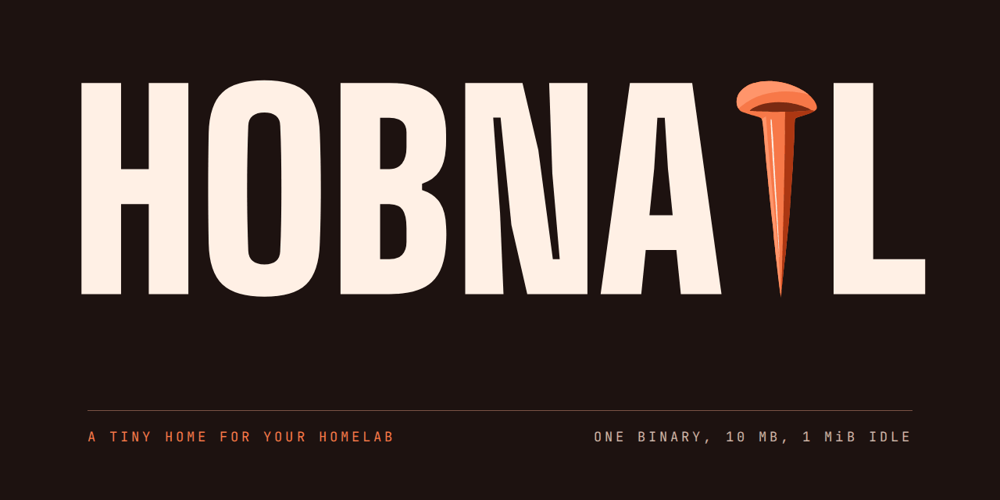

<p align="center">
  
</p>

# Hobnail

**A tiny home for your homelab.**

Hobnail is a home-server dashboard with a Rust server and an embedded React
client. One static binary runs in one `scratch` container; Node is build-time
only. It discovers Docker containers, shows host stats and history, tails logs,
fetches configured JSON widgets and sends notifications. Boards are curated in
the browser. Application data requires login.

The M5 image is **13.3 MB** (`docker images`; compressed content 4,578,941 B).
Warm-cache idle median: **1,722,368 B** of cgroup memory.current (1.642578125 MiB),
180 samples over 90 seconds on a fresh database/config. This excludes the
browser. Login hashing can exceed the 20 MiB peak budget; bundle and browser
budgets also have misses. Methods and limits: [React results](docs/plans/react-port-phase-2-5.md).

## Quick start

You need Docker with Compose.

```sh
git clone https://github.com/Rami-0/hobnail.git
cd hobnail
docker build -t hobnail:latest .
docker compose -f deploy/compose.yaml up -d
```

Open <http://127.0.0.1:3200/app> and set the owner username and password
in the browser. Use a fresh writable data directory for a new installation;
no console setup is needed. The first visitor claims the instance, so restrict
access during setup. The Owner invites Admin and Viewer accounts and can scope
their access to boards and integrations.

A new board is empty. Create and arrange it in Settings → Boards and edit mode,
then Save. Containers remain available as discovery suggestions. There is no
automatic All containers board. The app needs JavaScript. The old UI is on
`rust-only`; old URLs are gone and `/` returns 404 with a link to `/app`.
For an existing database, read the forward-only migration and legacy-password
recovery notes in [install](docs/install.md) before upgrading.

## Documentation

[Boards](docs/features/boards.md) · [Integrations](docs/features/integrations.md) ·
[Accounts and login](docs/features/login.md) · [HTTP API](docs/api.md)

| Topic | Read |
|---|---|
| Install, publish on your network, redeploy, CLI, environment variables | [docs/install.md](docs/install.md) |
| `config.toml`: page, groups, containers, labels, icons, theming | [docs/configuration.md](docs/configuration.md) |
| Login and what it protects | [docs/features/login.md](docs/features/login.md) |
| The interface, keyboard shortcuts, themes | [docs/features/ui.md](docs/features/ui.md) |
| Container discovery | [docs/features/containers.md](docs/features/containers.md) |
| Logs | [docs/features/logs.md](docs/features/logs.md) |
| Host page | [docs/features/host.md](docs/features/host.md) |
| History and its JSON API | [docs/features/history.md](docs/features/history.md) |
| Widgets | [docs/features/widgets.md](docs/features/widgets.md) |
| Notifications and alert rules | [docs/features/notifications.md](docs/features/notifications.md) |
| Settings in the app | [docs/features/settings.md](docs/features/settings.md) |
| Spec, design and measurements | [GOALS.md](GOALS.md), [docs/DESIGN.md](docs/DESIGN.md), [docs/measurements.md](docs/measurements.md) |
| Brand | [docs/BRANDING.md](docs/BRANDING.md) |
| QA audit: what was fixed and what is deferred | [docs/qa/QA.md](docs/qa/QA.md) |
| Binding React client and dashboard decisions | [docs/decisions/react-client-and-dashboard.md](docs/decisions/react-client-and-dashboard.md) |

Each topic has one page. The README only points to them.
